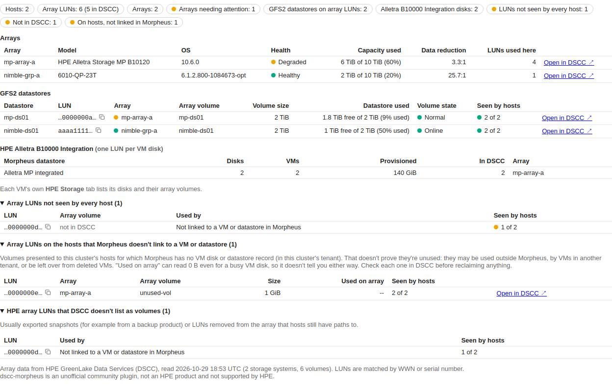
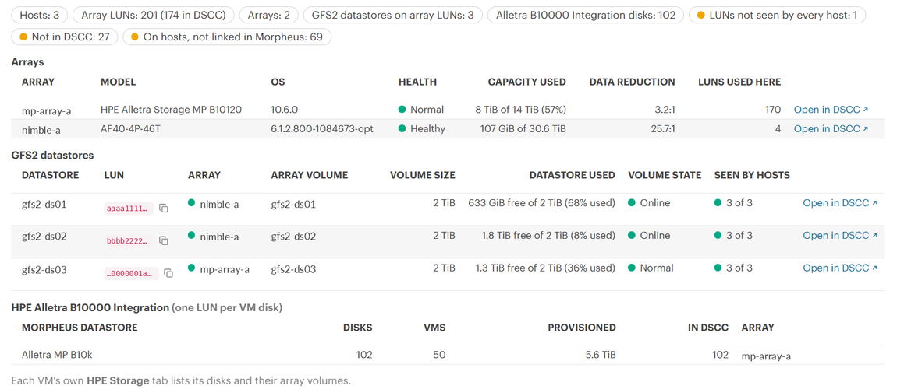
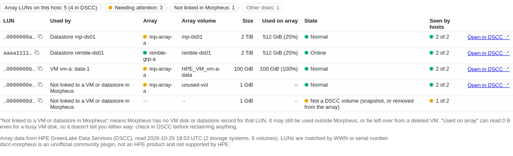
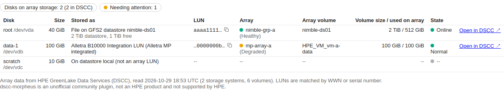
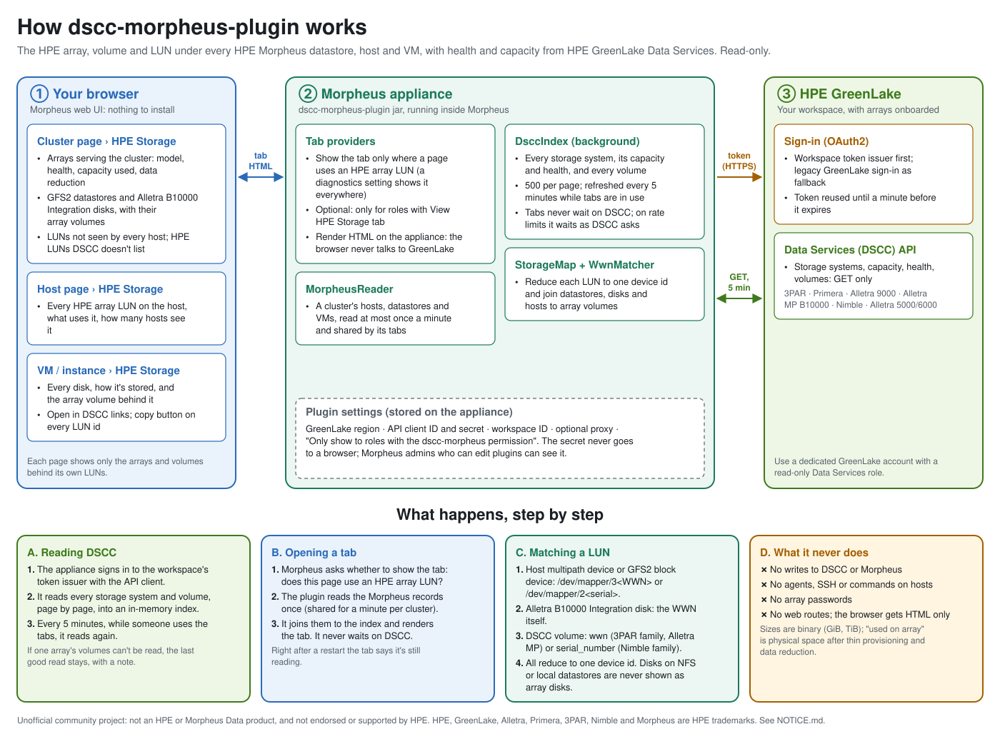

# dscc-morpheus-plugin

**Know exactly which HPE array, volume and LUN sits under every datastore, host and VM in HPE Morpheus, and whether it's healthy, right inside the Morpheus UI.** Array health, capacity, data reduction and volume state from HPE GreenLake Data Services, matched to your Morpheus storage by WWN. No storage console, no spreadsheets, no agents, no array passwords.

[](../../releases)
[](#requirements)
[](LICENSE)
[](CONTRIBUTING.md)

> **Unofficial community project.** Not an HPE or Morpheus Data product. Not developed, endorsed or supported by Hewlett Packard Enterprise. Provided as is, without warranty. HPE, HPE GreenLake, Alletra, Primera, 3PAR, Nimble Storage, HPE Morpheus and HPE Morpheus VM Essentials are trademarks of Hewlett Packard Enterprise; see [NOTICE.md](NOTICE.md) for trademarks and for every source this project was built from.



*All screenshots are rendered from anonymized test data.*

## Why you'll want it

- **Storage you can see from where you work.** The people who run your VMs see the array behind every datastore and disk, on the same page: which array, which volume, how big, how full, what state, and how healthy the array is.
- **Both kinds of Morpheus SAN storage.** GFS2 datastores built on a shared LUN, and disks on the **HPE Alletra B10000 Integration**, where every VM disk is its own LUN. The plugin follows each one to the right array volume.
- **A storage health check for every cluster.** One tab answers "which arrays serve this cluster, are they healthy, how full are they, and does every host see every LUN?" It also flags HPE LUNs your hosts see that the array doesn't list as volumes, the leftovers of snapshot exports and removed volumes.
- **Every HPE array family in one place.** HPE 3PAR, Primera, Alletra 9000, Alletra Storage MP B10000, Nimble and Alletra 5000/6000: anything onboarded to HPE GreenLake Data Services (DSCC).
- **Nothing to install, nothing to change.** The plugin matches LUNs using the device ids Morpheus and DSCC already store. It's read-only: no agents, no SSH, no array credentials, no writes anywhere.
- **One click to the array.** Every array and volume links to its page in the DSCC console, and every LUN id has a copy button for your tickets and CLI sessions.
- **Drop-in.** One jar for Morpheus 9.0 and later, a short settings form, and a test suite that runs against both plugin APIs.

## Get started

1. Download `dscc-morpheus-plugin-<version>.jar` from the [releases](../../releases).
2. In HPE GreenLake, create a personal API client (**IAM and administration → API access**) and note your workspace ID.
3. In Morpheus, upload the jar (Administration → Integrations → Plugins) and enter the region, client ID, secret and workspace ID.
4. Open a cluster, a hypervisor host or a VM: the **HPE Storage** tab is there.

Step-by-step instructions, written for someone doing this for the first time: **[docs/INSTALL.md](docs/INSTALL.md)**. How it works: **[How it works](#how-it-works)**.

## Tour

On a real Morpheus 9.0.1 cluster with an Alletra Storage MP and a Nimble group (names and ids replaced with examples):



The rest of the tour uses test data, so every state shows up.

**Cluster tab.** The arrays serving the cluster with model, OS, health, capacity and data reduction. Each GFS2 datastore with its LUN, array volume, free space, state and how many hosts see it. The Alletra B10000 Integration disks, grouped by datastore. And two checks: LUNs not every host sees, and HPE LUNs that DSCC doesn't list as volumes (shown at the top of this page).

**Host tab.** Every HPE array LUN the host sees: the array and volume behind it, its size, the space used on the array, its state, what uses it in Morpheus (a datastore, or a VM's disk) and how many of the cluster's hosts see it.



**VM tab** (on the VM's own page and on its instance page). One row per disk: is it a file on a GFS2 datastore, or its own Alletra B10000 Integration LUN? Which array and volume, how big, how full, and the array's health.



## What it does (0.2.0)

- **Appears only where it makes sense:** on clusters, hypervisor hosts and VMs that use at least one HPE array LUN. A diagnostics setting shows it everywhere.
- **Reads every HPE array in your DSCC workspace** in one background pass: systems, capacity, health and every volume, refreshed every five minutes while people use the tabs.
- **Matches by device id, automatically.** Morpheus and DSCC describe the same LUN in different ways; the plugin reduces them all to one id (see [How LUNs are matched](#how-luns-are-matched)).
- **Cluster tab:** arrays (model, OS, health, capacity used, data reduction ratio, LUNs used), GFS2 datastores, Alletra B10000 Integration disks, LUNs not seen by every host, and HPE LUNs DSCC doesn't list.
- **Host tab:** every HPE array LUN on the host, with what uses it and how many hosts see it.
- **VM tab:** every disk, how it's stored, and the array volume behind it.
- **Links:** **Open in DSCC** on every array and volume; a **copy** button on every LUN id.

### How LUNs are matched

| Where | What Morpheus or DSCC stores | Example |
|---|---|---|
| A host's multipath device, a GFS2 datastore's block device | `/dev/mapper/3<WWN>` (3PAR family), `/dev/mapper/2<serial>` (Nimble family) | `/dev/mapper/360002ac0…` |
| An Alletra B10000 Integration VM disk | the WWN, or `/dev/mapper/3<WWN>` | `60002ac0…` |
| A DSCC 3PAR, Primera, Alletra 9000 or Alletra MP volume | `wwn` | `60002AC0…` |
| A DSCC Nimble or Alletra 5000/6000 volume | `serial_number` | `…6c9ce9…` |

A VM disk that's a file on a GFS2 datastore is matched through the datastore's LUN. A disk on an NFS or local datastore is never shown as an array disk, even if Morpheus kept a WWN from an earlier LUN.

## Requirements

- HPE Morpheus **9.0.x or later**, including HPE Morpheus VM Essentials (tested on 9.0.1; the test suite also runs against the 9.1 plugin API).
- Clusters of hypervisor hosts that Morpheus manages, such as HVM (HPE Virtual Machine) clusters, with LUNs on HPE arrays: GFS2 datastores or HPE Alletra B10000 Integration disks.
- HPE arrays onboarded in an **HPE GreenLake** workspace with **Data Services** (DSCC).
- A GreenLake **personal API client** (service: *GreenLake platform and most services*) and your **workspace ID**. Ideally the client belongs to a dedicated GreenLake account with a read-only Data Services role, because the plugin acts as that account (see [Security](#security)).
- Outbound HTTPS from the Morpheus appliance to `<region>.data.cloud.hpe.com`, `global.api.greenlake.hpe.com` and `sso.common.cloud.hpe.com`. A proxy is supported.

## Download

Use the prebuilt jar from the [Releases](../../releases) page. There's no need to build anything.

**One jar, `dscc-morpheus-plugin-<version>.jar`, works on Morpheus 9.0.x and later.** It's compiled against the oldest supported Plugin API (1.4.1, Morpheus 9.0), and its whole test suite also runs against Plugin API 1.5.0 (Morpheus 9.1).

Each release includes `SHA256SUMS`. Check the download with `sha256sum -c SHA256SUMS`.

Then follow **[docs/INSTALL.md](docs/INSTALL.md)**.

## Security

### Who reads DSCC: one shared identity

The plugin uses **one GreenLake API client for the whole Morpheus appliance**: every tenant, cluster and user. A GreenLake *personal* API client **inherits the roles of the GreenLake user who created it**. So:

- **Everything the plugin reads from DSCC is read as that GreenLake user.** DSCC's audit shows that identity, not the Morpheus user.
- **The client can read whatever that user's Data Services role allows,** usually every array in the workspace. The plugin only *shows* the arrays and volumes behind each page's own LUNs, but it reads the whole workspace to build its index.
- **The client depends on its owner.** If that GreenLake user leaves or loses access, the plugin stops working.

**Therefore:** create the API client under a **dedicated GreenLake account** with a **read-only Data Services role**. The plugin never writes to DSCC, so it never needs more.

### Safeguards in the plugin

- **Read-only.** GET requests to DSCC only, and reads of Morpheus's own records. No writes anywhere, no web routes, and no commands on hosts.
- **Credentials stay on the appliance.** Only the Morpheus appliance talks to GreenLake. The plugin never sends the client secret to a browser. It's stored with the plugin settings, though, so **Morpheus administrators who can edit plugins can see it** in the Edit Plugin window.
- **Rotate the API client** in GreenLake (IAM and administration → API access) when someone who could see it leaves, or if you think it was exposed, then paste the new secret into the plugin settings.
- **Limits on what DSCC can send.** A response larger than 32 MiB isn't read, and a full read of DSCC stops after 10 minutes, keeping the previous data, so a misbehaving service can't fill the appliance's memory or tie up the plugin.
- **Tenants.** The cluster tab shows only to users of the cluster's tenant (or the master tenant), and lists only that tenant's hosts and VMs. Host and VM tabs check the tenant when Morpheus says who is viewing; when it doesn't (Morpheus 9.0.1 passes no viewer to these checks), the tab follows Morpheus's own access to the page.
- **Optional permission.** Turn on "Only show to roles with the dscc-morpheus permission" to limit the tabs to roles granted **dscc-morpheus: View HPE Storage tab**.
- **One small browser script,** loaded with the page's security nonce. It only copies a LUN id to the clipboard: no requests, no page changes.
- **Errors stay in the log.** DSCC's error bodies and unexpected errors can hold internal detail, so the tab shows a short message (with a reference number for unexpected errors) and the details go to the Morpheus log. When a refresh fails, the tabs keep showing the previous data with a note saying so, and the plugin waits a minute before trying again (longer when DSCC asks it to slow down).

To report a security problem, see [SECURITY.md](SECURITY.md).

## How it works



- **Only the Morpheus appliance talks to GreenLake,** over outbound HTTPS with one OAuth2 API client. The browser gets HTML rendered on the appliance.
- **Sign-in:** with a workspace ID, the plugin signs in through the workspace's own token issuer first, and uses the legacy GreenLake sign-in only as a fallback. Tokens are reused until a minute before they expire.
- **One background read:** every storage system, its capacity and health, and every volume (500 per page, only the fields the plugin uses), into an in-memory index refreshed every five minutes. Tabs never wait on DSCC; the first view after a restart says it's reading. If one array's volumes can't be read, its volumes from the previous read stay, with a note; if DSCC rate-limits the plugin, the read stops and waits as long as DSCC asks.
- **Morpheus records** for a cluster (hosts, datastores, VMs) are read at most once a minute and shared by all of that cluster's tabs; the cluster check reads only the hosts and datastores. A page's tab check and its tab share one read of the server or instance.
- **Units:** sizes are binary (GiB, TiB), as the arrays report them. "Used on array" is physical space after thin provisioning and data reduction, so a new thin volume can show 0 B.

The source is commented throughout: `DsccIndex` (what is read from DSCC, per array family), `StorageMap` (how LUNs, datastores and disks are joined), `MorpheusReader` (what is read from Morpheus), `WwnMatcher` (device ids).

## Build from source (optional)

You need only Docker; the build runs in a JDK 17 container.

```bash
tools/build.sh
```

This builds and tests the jar into `dist/`, then repeats the test suite against Plugin API 1.5.0. A first build downloads Gradle and its dependencies; later builds take a few minutes.

Optional checks (off by default):
- `PREVIEW_OUT=<dir>` renders the three tabs from test data to HTML (`PreviewSpec`); `tools/screenshots.py` turns them into the images in `docs/images`.
- `LOAD_JARS=<jar>` loads a built jar through the plugin API's own `PluginManager.registerPlugin` (`PluginLoadSpec`). Use a renamed build, because the loader is parent-first.

The tab templates are generated: edit `tools/templates/*.txt`, then run `tools/templates.py`.

## Known issues and limits

- **Morpheus 9.0.1 passes no viewer to host and VM tab checks.** Versions before 0.1.5 hid those tabs because of it. Use 0.1.5 or later.
- **HPE LUNs that DSCC doesn't list** are shown as "Not a DSCC volume (snapshot, or removed from the array)". Telling exported snapshots apart from removed volumes is planned.
- **DSCC alerts aren't shown yet.** DSCC's issues don't reliably name the array they belong to; array health comes from each array's own state.
- **No storage-viewer helper yet.** A script that creates a Morpheus role and user that can only view clusters, hosts, VMs and their HPE Storage tabs was held back from 0.1.8: on Morpheus 9.0.1 the user it created could open only User Settings, even with the Standard persona. Until it's fixed, give your storage team a role you build by hand, and include **dscc-morpheus: View HPE Storage tab** if you turned on "Only show to roles…". The earlier `create-readonly-user.py` was removed because it also granted Health and Logs.
- One DSCC workspace and region per Morpheus appliance. Set the region your workspace's Data Services is deployed in (GreenLake: Services → My services); arrays onboarded in another region don't show.
- The DSCC console address follows the region (`console-<region>.data.cloud.hpe.com`); the **DSCC console URL** setting overrides it.

## Contributing

**Pull requests are welcome.** See **[CONTRIBUTING.md](CONTRIBUTING.md)** for how to build, test and submit changes. Use the [issue templates](../../issues/new/choose) for bugs and ideas, and report security problems privately.

## Sources, attribution and trademarks

This plugin was written from scratch, using HPE's public documentation and the Morpheus plugin API as references, and follows the architecture of its sibling project [com-morpheus-plugin](https://github.com/grahamfairbank/com-morpheus-plugin). It is an independent community project, not an HPE product, and isn't supported by HPE. **[NOTICE.md](NOTICE.md)** lists every source, its license and exactly how it was used, how the test data and screenshots were made, and the full trademark notices.

HPE, HPE GreenLake, Data Services Cloud Console (DSCC), HPE Alletra, HPE Alletra Storage MP, HPE Primera, HPE 3PAR, HPE Nimble Storage, HPE Compute Ops Management and HPE Morpheus (including HPE Morpheus VM Essentials) are trademarks of Hewlett Packard Enterprise or its affiliates, used here only to describe what the plugin works with.

## License

[MIT](LICENSE) for this project's own code. The Morpheus plugin API it compiles against is licensed separately by Morpheus Data, LLC and isn't included.
