# Installing dscc-morpheus-plugin

> Unofficial community plugin, not an HPE product and not supported by HPE. See [NOTICE.md](../NOTICE.md).

This guide assumes you've never installed an HPE Morpheus plugin or created a GreenLake API client before. Every step says where to click and what you should see. Allow about 20 minutes.

## Before you start

You need:

- **Morpheus admin access.** HPE Morpheus **9.0.x or later** (including HPE Morpheus VM Essentials), and a login that can open **Administration → Integrations → Plugins**.
- **Access to your HPE GreenLake workspace**, the one where your HPE arrays are onboarded in **Data Services** (DSCC), with permission to create API clients.
- **Network access from the Morpheus appliance** (the manager, not your laptop) to these addresses on port 443:
  - `<region>.data.cloud.hpe.com` (for example `us1.data.cloud.hpe.com`)
  - `global.api.greenlake.hpe.com`
  - `sso.common.cloud.hpe.com`

  If the appliance reaches the internet through a proxy, have its address ready (for example `http://proxy.example.com:3128`).

**Use the region your workspace's Data Services is deployed in.** In the GreenLake portal, each service in a workspace is deployed to a region, and your arrays are onboarded to Data Services in that region. The plugin must connect to the same one, or it finds no arrays:

| Data Services region in GreenLake | Plugin setting | Console address |
|---|---|---|
| US West | `us1` | `console-us1.data.cloud.hpe.com` |
| EU Central | `eu1` | `console-eu1.data.cloud.hpe.com` |
| AP Northeast | `jp1` | `console-jp1.data.cloud.hpe.com` |

Not sure which? In GreenLake, open **Services → My services** and look at the region next to Data Services. Or open **Data Services** from your workspace: the console address in your browser starts with `console-us1`, `console-eu1` or `console-jp1`, and that's your region. If your workspace has Data Services in more than one region, use the one where these arrays are onboarded.

## 1. Find your GreenLake workspace ID

The workspace ID tells GreenLake which workspace the plugin's sign-in is for. Without it, DSCC can accept the sign-in and still refuse every read with "failed to authorize", especially if you have access to several workspaces.

1. Sign in to [HPE GreenLake](https://common.cloud.hpe.com) and switch to the workspace that holds your arrays (the workspace name is at the top left, next to the GreenLake logo).
2. Open the menu (the ☰ icon at the top left), then **IAM and administration → Workspace details**.

   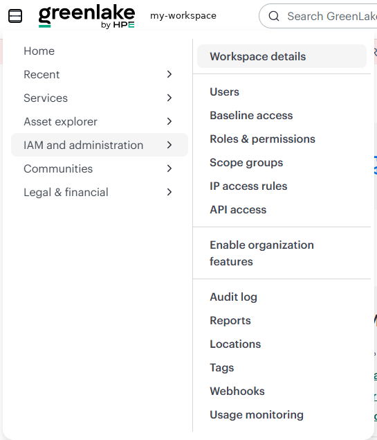

3. Copy the **Workspace ID**. It's 32 letters and digits, like `4f2a9c7e1b8d4e6fa3c5d7e9b1f20a64` in the example below. Paste it into a note for step 4.

   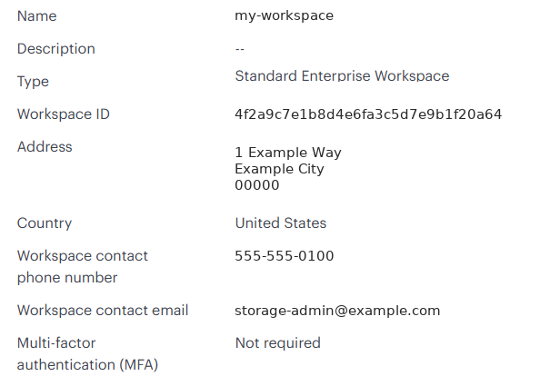

## 2. Create an API client (GreenLake)

> **The plugin reads DSCC as the GreenLake user who creates this API client,** for everyone on the Morpheus appliance. A personal API client has exactly its creator's permissions, at the time it's used. Use a **dedicated account** (a service or shared admin account under your organization's rules) with a **read-only Data Services role**. The plugin never writes to DSCC, so it never needs more. See [Security](../README.md#security).

1. Sign in to GreenLake as that dedicated account, in the same workspace.
2. Open the menu, then **IAM and administration → API access**, and click **Create personal API client**.

   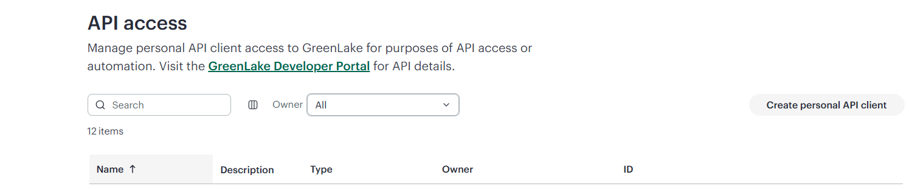

3. **Name:** something you'll recognize later, for example `Morpheus-API-Client`.
4. **Service:** choose **GreenLake platform and most services**. (Data Services uses the same sign-in as the platform, so there's no separate "Data Services" choice.)

   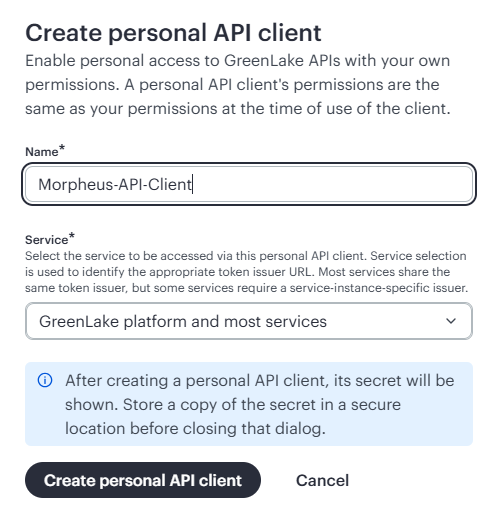

5. Click **Create personal API client**. GreenLake now shows the **Issuer URL**, the **Client ID** and the **Secret**. Copy the client ID and the secret into your note. In the example below, the client ID is `7c3e8a12-5b4f-4d9e-a6c1-2f8b0d4e9a37`.

   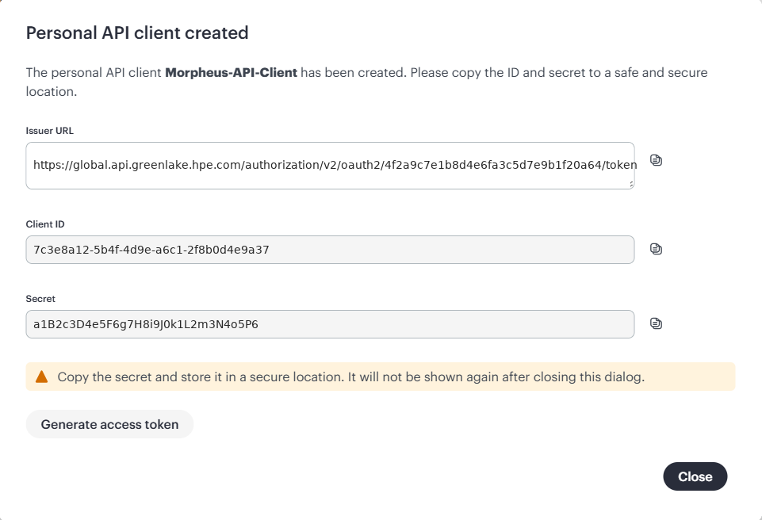

   - **The secret is shown only once.** If you lose it, create a new client.
   - The **Issuer URL** ends in `/oauth2/<workspace ID>/token`: that's the same workspace ID as in step 1 (`4f2a9c7e1b8d4e6fa3c5d7e9b1f20a64` in the examples), a handy way to double-check it.
   - You don't need **Generate access token**: the plugin makes its own tokens.

## 3. Upload the plugin (Morpheus)

1. Download `dscc-morpheus-plugin-<version>.jar` and `SHA256SUMS` from the [Releases](https://github.com/grahamfairbank/dscc-morpheus-plugin/releases) page.
2. Optional but recommended: check the download. In a terminal in the download folder, run `sha256sum -c SHA256SUMS` (Linux and macOS) or `certutil -hashfile dscc-morpheus-plugin-<version>.jar SHA256` (Windows) and compare it with the value in `SHA256SUMS`.
3. In Morpheus, go to **Administration → Integrations → Plugins**.
4. Click **Add**, choose the jar, and upload it.
5. After a few seconds, **dscc-morpheus** appears in the plugin list, with the version you downloaded and a check mark under **Enabled**.

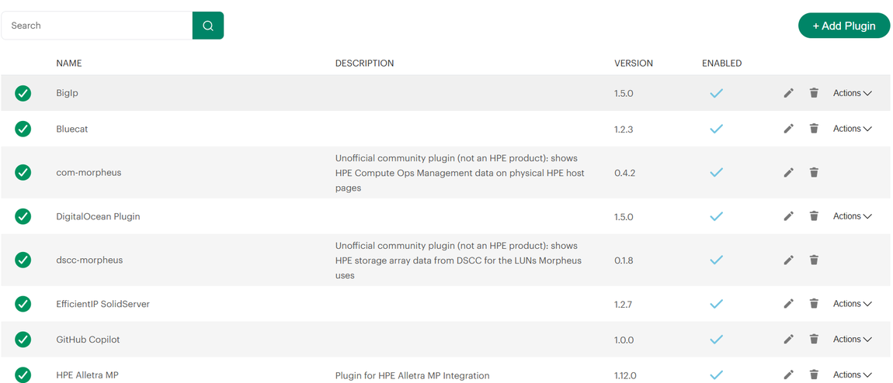

**Upgrading:** upload the new jar the same way: **+ Add Plugin**, choose the new jar, **Upload**. Morpheus replaces the old version in place, and your settings are kept.

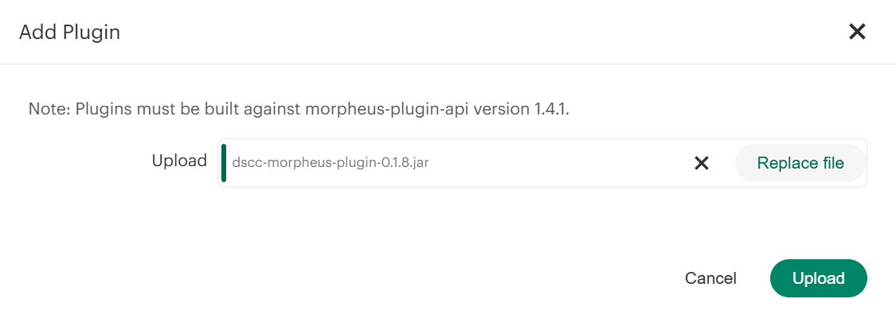

 **Removing:** delete the plugin from the same list. It leaves nothing behind in Morpheus, on hosts or in DSCC.

## 4. Enter the settings

1. In **Administration → Integrations → Plugins**, click the pencil icon on the **dscc-morpheus** row. The **Edit Plugin** window opens.
2. Fill in:

| Setting | What to enter |
|---|---|
| DSCC region | `us1`, `eu1` or `jp1`: the region your workspace's Data Services is deployed in (see "Before you start") |
| API client ID | from step 2 (example: `7c3e8a12-5b4f-4d9e-a6c1-2f8b0d4e9a37`) |
| API client secret | from step 2 |
| GreenLake workspace ID | from step 1 (example: `4f2a9c7e1b8d4e6fa3c5d7e9b1f20a64`) |
| Token URL override | leave blank |
| DSCC console URL | leave blank (set it only if "Open in DSCC" opens the wrong console) |
| HTTP proxy for GreenLake | blank, or `http://proxy:port` if the appliance needs a proxy (no proxy authentication) |
| Only show to roles with the dscc-morpheus permission | off: everyone who can see a cluster, host or VM sees its tab. On: only roles granted the permission in step 5. |
| Show the tab even without HPE array LUNs | off. Turn it on only for troubleshooting. |

3. Click **Save Changes**.

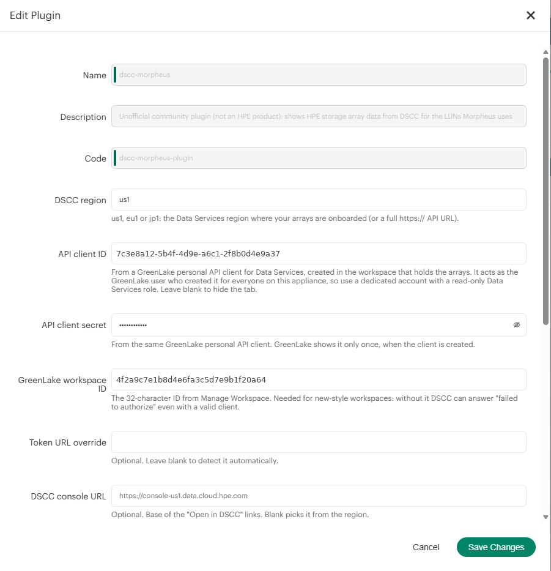

Further down the same window: the two options and the plugin's providers (the script loader and the three HPE Storage tabs).

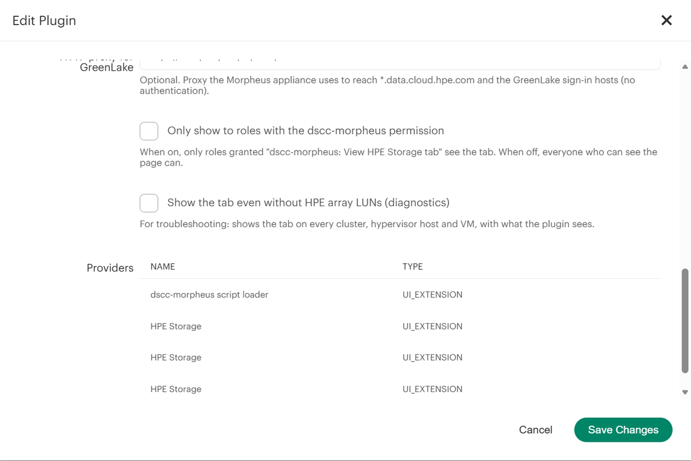

## 5. Permissions (only if you turned on "Only show to roles…")

The plugin adds one permission. In **Administration → Roles**, open each role that should see the tabs, go to its permissions, find **dscc-morpheus: View HPE Storage tab**, set it to **Read**, and save.

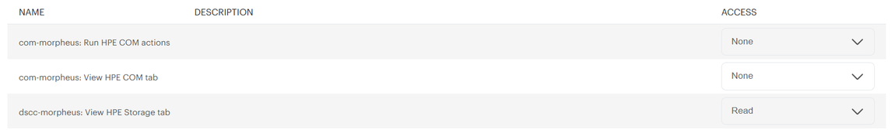

## 6. Check it

1. Open a cluster that uses HPE array storage: **Infrastructure → Clusters → (your cluster)**, then its **HPE Storage** tab.
2. The very first time (and after Morpheus or the plugin restarts) the tab says it's **reading the storage arrays and volumes from DSCC**. That takes a few seconds to a minute. Open the tab again.
3. You should see your arrays, your GFS2 datastores and any Alletra B10000 Integration disks.

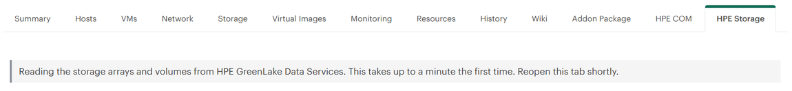

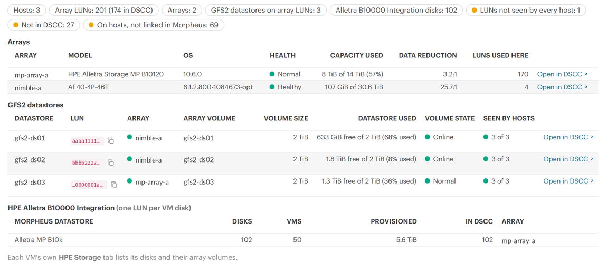

Further down, the cluster's checks. Each heading opens a list:

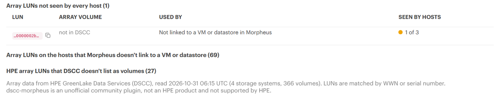

4. Open a hypervisor host: **Infrastructure → Compute → (host)**. Morpheus puts extra tabs under the **▼** menu at the right end of the tab row, so look there for **HPE Storage**.
5. Open a VM that has a disk on array storage, from **Infrastructure → Compute** or **Provisioning → Instances**. Its **HPE Storage** tab lists each disk.

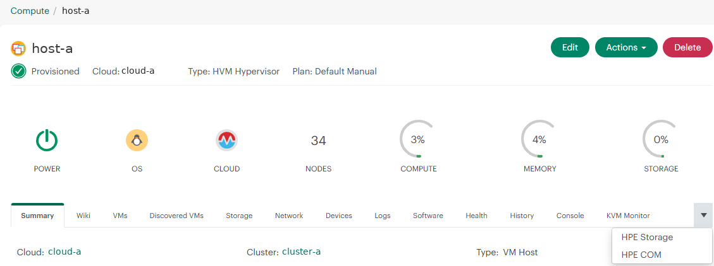

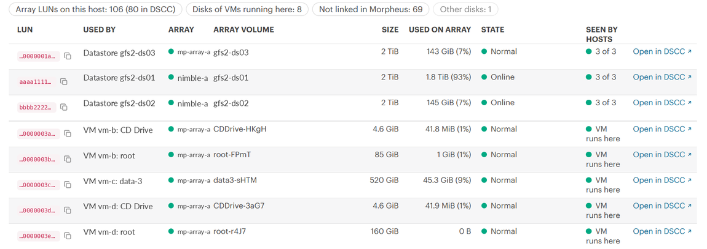

At the bottom of the host tab: LUNs on the host that Morpheus doesn't link to a VM or datastore, and what that means. Check those in DSCC before reclaiming anything: "used on array" can read 0 B even for a busy disk.

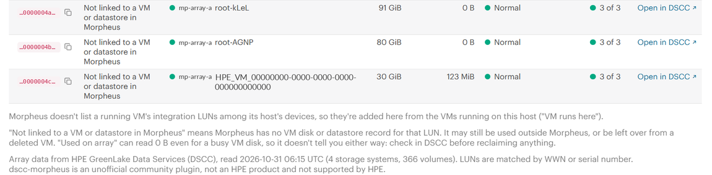

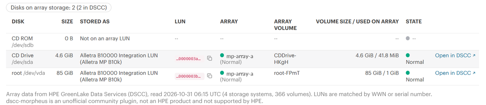

If a tab doesn't appear, see Troubleshooting below.

## Troubleshooting

| What you see | What it means and what to do |
|---|---|
| No HPE Storage tab anywhere | Check the client ID and secret are saved. Look under the **▼** menu. Turn on "Show the tab even without HPE array LUNs" to see what the plugin sees. |
| Tab on clusters, not on hosts or VMs | Use 0.1.5 or later (Morpheus 9.0.1 passes no viewer to those tab checks). Then check the log, below. |
| "DSCC authorized no access for this API client" | The workspace ID is missing or wrong (step 1), or the client's GreenLake user has no Data Services role in that workspace. |
| "Couldn't sign in to GreenLake…" | Wrong client ID or secret, or the client was deleted. Create a new one (step 2). |
| "Couldn't reach DSCC…" | The appliance can't reach GreenLake: check DNS and the firewall, or set the HTTP proxy. |
| Arrays show but a datastore's array is "--" | Its LUN isn't a volume DSCC knows: the array isn't onboarded in this workspace, or it's onboarded in another Data Services region than the plugin's **DSCC region** setting. |
| "Not a DSCC volume (snapshot, or removed from the array)" | An HPE LUN the hosts can see that the array doesn't list as a volume: usually an exported snapshot (for example from a backup product) or a volume removed from the array while hosts still have paths to it. |
| "Used on array" shows 0 B | Normal for thin volumes with little data: it's physical space after data reduction. |
| Numbers look a few minutes old | The plugin reads DSCC every five minutes while people use the tabs. |
| Upload does nothing, or "Failed to parse plugin file" | A corrupt or incomplete download: check it with `SHA256SUMS`. |

**The Morpheus log.** The plugin writes to the Morpheus application log (**Administration → Health → Morpheus Logs**, or `/var/log/morpheus/morpheus-ui/current` on the appliance) with the prefix `dscc-morpheus:`. When a host or VM tab is hidden, it logs why, once every 10 minutes per page, for example:

```text
dscc-morpheus: no HPE Storage tab for host 12: no HPE array LUN among 4 devices
```

Include those lines when you open an [issue](https://github.com/grahamfairbank/dscc-morpheus-plugin/issues/new/choose).
